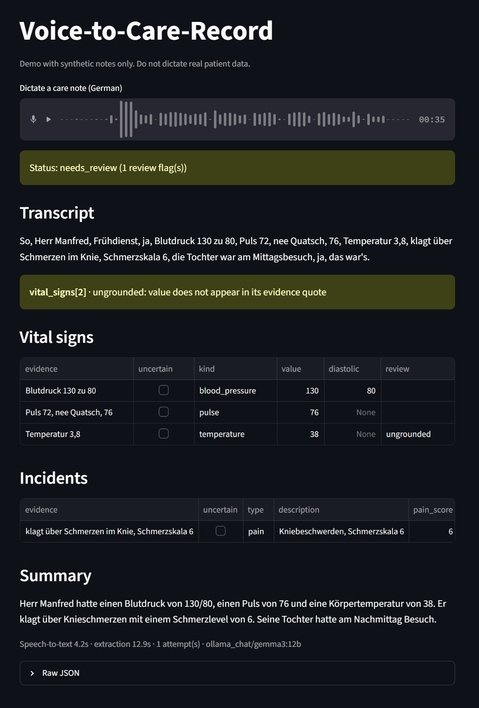

# Voice-to-Care-Record Assistant

Caregivers in elderly care dictate a short voice note after a shift. This project turns that
note into a **validated, structured care record (JSON)** and **flags anything uncertain for
human review** instead of guessing.



*Live test with my own voice. I also made an intentional error by saing "temperature 3,6", to see how the model deals with it: the model turned "Temperatur 3,8" into 38, and validation flagged it as `ungrounded`.*

```
Audio ─► [1 STT: faster-whisper, local] ─► Transcript ─► [2 LLM extraction] ─► JSON CareRecord ─► [3 validation] ─► [4 evaluation harness vs. synthetic ground truth]
```

## What it does

| Step | Implementation | File |
|---|---|---|
| Speech-to-text | `faster-whisper`, German, runs offline | `care_record/stt.py` |
| Extraction | One LLM call via `litellm`; same code for API and local (Ollama) models | `care_record/llm.py`, `extraction.py` |
| Schema | Pydantic models; observations follow the 6 SIS topic areas, plus vital signs, medications (given/refused), incidents (fall/pain/wound/other), summary | `care_record/schema.py` |
| Validation & fallback | Invalid JSON → retry once with the validation error fed back → if still invalid, keep the items that validate and flag the rest | `care_record/extraction.py` |
| Review flags | `uncertain` (model hedged), `ungrounded` (quote not in transcript, or number not in its own quote), `implausible` (out of physiological range), `invalid`, `extraction_failed` | `care_record/validation.py` |
| Synthetic data | Ground truth first, then spoken-style German notes rendered from it (45 cases, 9 categories; a dev set and a held-out test set) | `care_record/synth.py` |
| Evaluation | Field-level P/R/F1, hallucinations, misplaced items, wrong values, review recall, schema validity, latency | `care_record/metrics.py`, `evaluate.py` |
| Live demo | Streamlit app: record a note with the microphone, see the record with its review flags | `app.py` |

Every extracted item carries an `evidence` field with the exact transcript quote it is based on.

### SIS topic areas
The observation areas follow the six *Themenfelder* of the SIS (Strukturierte
Informationssammlung, Strukturmodell): 1 kognitive und kommunikative Fähigkeiten,
2 Mobilität und Beweglichkeit, 3 krankheitsbezogene Anforderungen und Belastungen,
4 Selbstversorgung, 5 Leben in sozialen Beziehungen, 6 Wohnen/Häuslichkeit (stationär)
bzw. Haushaltsführung (ambulant).

## How to run

```bash
python -m venv .venv
.venv/Scripts/activate            # Windows; source .venv/bin/activate elsewhere
pip install -e ".[dev]"           # add ,stt,ui for Whisper and Streamlit
ollama pull gemma3:12b            # free local default model (needs Ollama)
```

```bash
streamlit run app.py                                  # To run the app (live test): dictate a note with the microphone

# Additional functional calls
care generate                                         # regenerate data/synthetic/cases.jsonl
care process note.txt                                 # text note -> care record
care process note.wav                                 # audio: local Whisper first
care evaluate data/synthetic/cases.jsonl              # writes results/runs/<run>/ and results/summary.csv
care evaluate data/synthetic/cases_test.jsonl --limit 10
```

Whisper runs on the GPU if the CUDA libraries (cuBLAS, cuDNN) are installed, otherwise on the CPU
(about 4 s for a 25 s note with `large-v3-turbo`).

Models are plain litellm strings, so an API model works too: `--model anthropic/claude-haiku-5-5`
(needs the provider key, e.g. `ANTHROPIC_API_KEY`). Defaults can be set with `CARE_MODEL` and
`CARE_WHISPER_MODEL`.

## Synthetic data

No real patient data is used anywhere. `care_record/synth.py` samples a ground-truth record,
then renders each fact as a spoken German phrase (filler words, "RR 130 zu 80",
"hundertdreißig", "Panto 40", …). Each phrase is inserted verbatim, so it is also the
ground-truth evidence. Generation is seeded and reproducible: `cases.jsonl` (seed 42) is the
dev set used while changing the prompt, `cases_test.jsonl` (seed 1042) is only used for reporting.

| Category | n | What it tests |
|---|---|---|
| standard | 16 | normal notes, mixed digits/words |
| nothing_noteworthy | 4 | empty record must stay empty |
| missing_value | 4 | "Blutdruck gemessen, Wert trag ich nach" → must not produce a value |
| self_correction | 4 | "Puls 72, nee, Quatsch, 76" → 76 |
| spoken_numbers | 4 | all numbers as German words |
| refused_meds | 4 | medication status `refused` |
| hedged | 3 | "so um die 38, glaub ich" → extract + flag |
| contradiction | 3 | conflicting statements → extract + flag |
| implausible | 3 | "Temperatur drei komma acht" → extract + flag |

## Evaluation method

Items are matched per section by entity (vital kind, drug name, incident type, SIS area):

- **correct**: entity and value match
- **wrong value**: entity found, value wrong (e.g. pulse 76 instead of 72)
- **hallucination** – predicted entity that is not in the note
- **misplaced**: predicted in the wrong section, e.g. "Luftnot" filed as an incident instead of an observation
- **missed**: truth entity not predicted

Hallucinations are reported separately and weighted highest
(`safety_error_score = (3 hallucinated + 2 wrong + 1 missed + 1 misplaced) / truth items`), because in care
documentation an invented entry such as "Ramipril given" is worse than a missing one.
For items the ground truth marks as needing review (hedged, contradictory, implausible), the
system only has to find the entity and flag it; `review_recall` measures how often it does.
Observations (free text in an SIS area) are scored separately and kept out of the
hallucination rate, since the area assignment is partly a judgement call.

## Results

`gemma3:12b` via Ollama (local, free, temperature 0) on text transcripts, 45 notes per set, on an
RTX 5070 Ti. Scores cover the critical sections (vital signs, medications, incidents). Every run
is a row in [`results/summary.csv`](results/summary.csv).

| Version | Set | F1 | Halluc. | Wrong values | Missed | Safety error ↓ | Review recall | Valid JSON (1st try) | Time / note |
|---|---|---|---|---|---|---|---|---|---|
| Baseline prompt | dev | 0.926 | 0 | 4 | 9 | 0.144 | 6/12 | 96 % | 6.0 s |
| Prompt fix | dev | 0.935 | 1 | 4 | 6 | 0.144 | 10/12 | 91 % | 6.1 s |
| Final (simplified code) | dev | 0.918 | 0 | 5 | 8 | 0.160 | 8/12 | 89 % | 5.9 s |
| Baseline prompt | test | 0.875 | 3 | 3 | 20 | 0.281 | 6/12 | 89 % | 6.2 s |
| Prompt fix | test | 0.920 | 1 | 2 | 13 | 0.170 | 12/12 | 87 % | 6.3 s |
| Final (simplified code) | test | 0.920 | 0 | 3 | 12 | 0.156 | 11/12 | 87 % | 6.1 s |

"Final" uses the same prompt as "Prompt fix", after the code was simplified (exact grounding,
fewer metrics).

- **The prompt fix is the one change that clearly helped:** contradictions are now flagged
  (review recall 6/12 → 10–12/12), and on the test set the safety error dropped from 0.281 to
  0.170. The test set was not used for tuning.
- **Invented entries are rare** (0–1 per 45 notes after the fix). Most remaining errors are
  missed items, especially incidents (incident F1 0.68–0.81, vital signs and medications 0.92–1.0).
- **Invalid JSON is not lost:** notes that are still invalid after the retry (4–11 %) keep their
  valid items, and the dropped ones are flagged.
- **Runs are noisy:** Ollama is not fully deterministic at temperature 0. About half of the notes
  differ between two runs with identical prompt and model, so differences of a few F1 points
  (e.g. 0.935 vs. 0.918 on dev) are noise, not regressions.

## Limitations

- Template-generated notes are cleaner and less varied than real dictation; 45 notes per set is
  small, and results vary between runs.
- One model only (gemma3:12b), evaluated on text. A comparison with an API model and an
  evaluation on audio were left out to keep the project small; speech-to-text was only tested by hand.
- Drug names are not checked against a drug list: Whisper heard a synthetic voice's "Ramipril"
  as "M April", and the record contained a medication "M April" without a flag.
- The summary has no evidence quote and is not validated, so it could state something that is
  not in the note. In the screenshot it repeats the wrong temperature (38) and turns a
  lunchtime visit ("Mittagsbesuch") into an afternoon visit.
- Grounding is an exact text match, so a quote with a different filler word is flagged
  (debugging example 3).
- Observation scoring only checks the SIS area, not the content of the text.
- Plausibility ranges are generic adult ranges, not per-resident thresholds.

## Privacy

- STT runs locally; with a local model the whole pipeline is offline.
- With an API model the transcript leaves the machine; real deployment would need a DPA,
  EU hosting and pseudonymisation of names before the call.
- The dataset is fully synthetic.

## Development workflow

I built this project together with [Claude Code](https://claude.com/claude-code).

## Debugging examples

**1. Contradictions were extracted without a flag.** In the baseline run none of the six
contradiction items was flagged (review recall 6/12). Example from the dev set:

> „kein Sturz heute, wobei, sie saß vorhin auf dem Boden vorm Bett … Metformin hab ich gegeben,
> also, die Tablette lag später aber noch auf dem Nachttisch"

Fix in the prompt (`1448dfd`): contradictory statements are extracted with `uncertain: true`, a
possible fall is a fall incident, and each statement goes into exactly one section. Review recall
rose to 10/12 (dev) and 12/12 (test), incident F1 on dev from 0.69 to 0.81.

**2. The model "corrected" a number, and validation caught it.** In an audio test (a note read
by the German Windows text-to-speech voice), Whisper wrote "Temperatur 3,8" and gemma extracted
**38.0**: a plausible-looking value that is not in the note. `value_in_evidence` flagged it as
`ungrounded` ("value does not appear in its evidence quote"). With the same note as text
("drei komma acht"), the model kept 3.8 and the plausibility check flagged it as `implausible`.
Either way a human sees it, and no value is changed silently.

**3. Exact grounding raises false alarms (not fixed).** In the final dev run 13 items got
"evidence not found in transcript". 12 of them were real quotes in which the model copied the
wrong filler word at the start ("Ähm," instead of "Ach ja,"); only one quote was really not in the
transcript. The false alarms are on the safe side (a human checks too much, not too little);
ignoring filler words when comparing would remove them.
